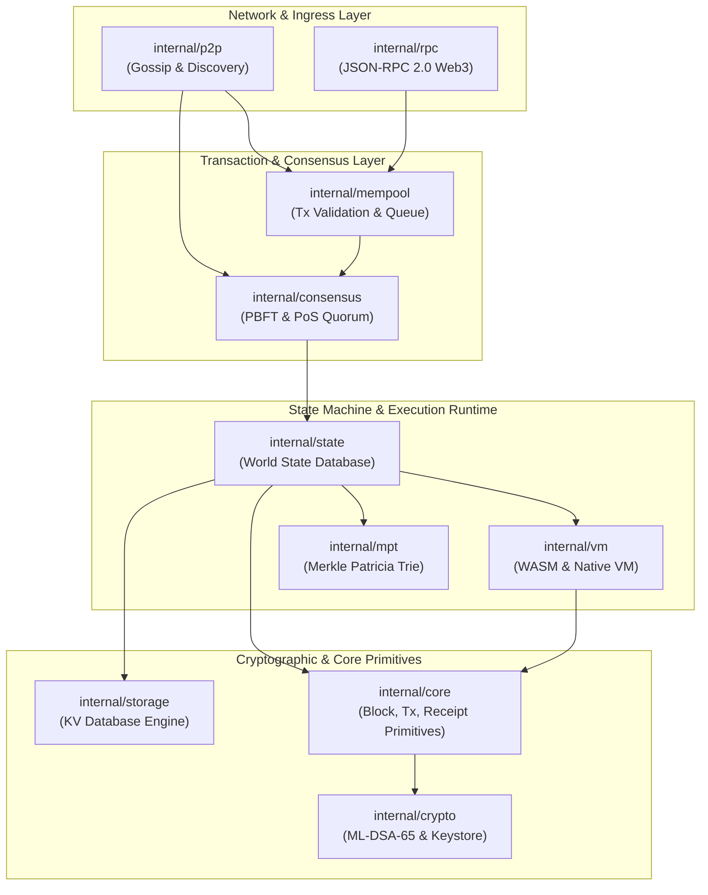

# Oenexa: Layer-1 Blockchain Modular Design System & SRP Standards ⚡

> **Repository**: `oenexa-node`  
> **Status**: Production Blockchain Architecture Standard  
> **Target Audience**: Human Blockchain Engineers & Autonomous AI Coding Agents  
> **Language**: Go 1.23+  
> **Last Updated**: 2026-10-04  

---

## 1. Architectural Philosophy & Principles

### 1.1 Single Responsibility Principle (SRP) in Go
In idiomatic Go, package names are not generic catch-alls (e.g., `utils`, `common`, `helpers`). Every package in `oenexa-node` must encapsulate **exactly one single domain responsibility**:
- **Anti-Pattern**: Putting block validation, crypto hashing, state mutations, and RPC responses into one package or God-struct.
- **Enforced Pattern**: Fine-grained, decoupled internal packages where each package has a single, well-defined invariant (e.g., `internal/crypto` only computes cryptographic operations; `internal/mpt` only computes Merkle Patricia Trie proofs).

### 1.2 Strict Layer-1 Protocol Boundary (Non-Negotiable)
- **Pure L1 Protocol Engine**: `oenexa-node` is strictly a Layer-1 Proof-of-Stake consensus and state machine.
- **Zero Consumer Business Logic**: Consumer application domains (such as food delivery, e-commerce, merchant portals, fiat payment gateways) **MUST NEVER** enter this repository. All higher-layer consumer applications interface via the decoupled Web3 JSON-RPC 2.0 gateway.

### 1.3 Interface Segregation & Dependency Inversion
- **Accept Interfaces, Return Structs**: Functions and components must accept minimal, focused interfaces and return concrete types.
- **No Package Cycles**: Circular package dependencies are forbidden by the Go compiler and architectural policy. Dependency flows strictly downward toward `internal/core`.

---

## 2. Directory Structure & Package Hierarchy (`oenexa-node`)

```text
oenexa-node/
├── cmd/                                   # Application Entrypoints (Executables)
│   ├── node/                              # Main Oenexa L1 validator & full-node daemon
│   ├── oenexa-cli/                        # Official CLI wallet, keystore & node query tool
│   ├── healthcheck/                       # Lightweight container health check probe
│   ├── loadtest/                          # High-throughput benchmark & TPS generator
│   └── multisig/                          # Multisig threshold signature coordinator CLI
│
├── internal/                              # Isolated L1 Protocol Engines (Private Packages)
│   ├── config/                            # Node configurations, flags & genesis loader
│   ├── core/                              # Pure block, header, tx & receipt data primitives
│   ├── consensus/                         # PBFT + PoS consensus engine & validator quorum
│   ├── crypto/                            # Post-quantum ML-DSA-65, Falcon-512 & Ed25519
│   ├── keystore/                          # Encrypted key storage & BIP-39 mnemonic signer
│   ├── state/                             # Deterministic world state machine & account balances
│   ├── mpt/                               # Cryptographic Merkle Patricia Trie implementation
│   ├── mempool/                           # Transaction pool, nonce checks & gas prioritization
│   ├── vm/                                # Sandboxed WASM (Wazero) & EVM execution runtime
│   ├── contracts/                         # Native system contracts (multisig, governance, global)
│   ├── p2p/                               # Libp2p peer discovery, peer table & gossipsub
│   ├── rpc/                               # Web3 JSON-RPC 2.0 (oen_*, eth_*, net_* namespaces)
│   ├── storage/                           # LevelDB / RocksDB key-value persistence engine
│   ├── shielded/                          # Zero-knowledge privacy layer & confidential transfers
│   ├── oracle/                            # Decentralized price feeds & external data consensus
│   ├── rollup/                            # Layer-2 optimistic & ZK state anchor verifier
│   ├── identity/                          # Decentralized identity (OenexaID) & verifiable claims
│   ├── sync/                              # Fast-sync, header sync & block catch-up engine
│   ├── upgrade/                           # Hard-fork scheduler & on-chain protocol upgrades
│   └── metrics/                           # Prometheus metrics exporter & real-time telemetry
│
├── configs/                               # Genesis configs & network parameter presets
├── docs/                                  # Technical specifications & whitepapers
└── test/                                  # BDD end-to-end integration & fuzzing test suites
```

---

## 3. Package Domain Responsibilities



### 3.1 `internal/core` (Zero External Dependencies)
- **Single Responsibility**: Defines pure blockchain data structures: `Block`, `Header`, `Transaction`, `Receipt`, `Hash`, and serialization methods.
- **Rule**: Must never import `internal/consensus`, `internal/rpc`, `internal/p2p`, or `internal/vm`.

### 3.2 `internal/crypto` (Cryptographic Purity)
- **Single Responsibility**: Cryptographic operations including post-quantum signatures (NIST FIPS 204 ML-DSA-65), Falcon-512, Ed25519, SHA-3, and Keccak-256.
- **Rule**: Completely stateless and deterministic.

### 3.3 `internal/consensus` (Quorum & Finality)
- **Single Responsibility**: Implements PBFT consensus rounds, validator staking weights, slashing conditions, and block proposal authorization.
- **Rule**: Consensus coordinates block ordering; it delegates transaction execution entirely to `internal/state`.

### 3.4 `internal/state` (Deterministic World State)
- **Single Responsibility**: Maintains account balances, nonces, and storage trie roots. Applies state transitions deterministically.
- **Rule**: State mutations must be transactional and rollback-capable via journal checkpoints.

### 3.5 `internal/vm` (Sandboxed Execution)
- **Single Responsibility**: Sandboxed virtual machine runtime for executing WASM contracts (via Wazero) and native smart contracts.
- **Rule**: Smart contract execution must be strictly gas-metered, CPU-bounded, and isolated from OS file/network access.

### 3.6 `internal/mempool` (Transaction Ingress Validation)
- **Single Responsibility**: Validates transaction signatures, prevents replay attacks via account nonces, enforces fee thresholds, and orders transactions into priority queues.

### 3.7 `internal/rpc` (Decoupled Web3 Interface)
- **Single Responsibility**: Translates JSON-RPC 2.0 requests from external dApps and clients into internal node operations.

---

## 4. Blockchain Developer & AI Agent Guidelines

Future blockchain engineers and autonomous AI agents working in `oenexa-node` **must** strictly adhere to the following rules:

### Rule 1: No God-Packages or Spaghetti Dependencies
- Every file must focus on a single struct or interface implementation.
- Keep file sizes under 400 lines where practical.
- Never cross layer boundaries (e.g. `internal/core` must not know about HTTP, WebSockets, or P2P sockets).

### Rule 2: Determinism Invariant
- Any logic touching state transitions, block hashing, or transaction verification must be **100% deterministic**.
- Never use non-deterministic sources (such as system clocks `time.Now()`, random number generators without seeds, or iterating un-sorted maps) inside consensus or state execution.

### Rule 3: Zero-Bug & 100% Verification Gate
Before committing or pushing any code to `main`:
```bash
# 1. All unit and integration test packages must pass
go test ./...

# 2. Daemon binary must compile with CGO_ENABLED=0
go build -o /dev/null ./cmd/node
```
Any PR or commit that breaks `go test ./...` is a critical protocol violation and will be rejected immediately.
