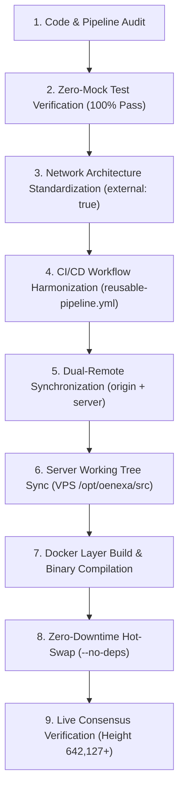

# OENEXA Node: Engineering, Operations & Troubleshooting Manual

## Executive Summary
This document provides an exhaustive, developer-ready and AI-agent-ready guide to the architecture, upgrade lifecycle, operational procedures, and incident remediation protocols for **`oenexa-node`** (the sovereign Layer-1 Post-Quantum blockchain node) within the Oenexa decentralized ecosystem.

---

## 1. Methodology: How the Node Was Updated



### Step-by-Step Technical Execution

1. **Audit & Codebase Inspection:**
   - Inspected repository structure: verified Go 1.26 module boundaries (`github.com/oenexa/oenexa`), dependencies (Circl post-quantum cryptography, libp2p, goleveldb, wazero WASM runtime), and environment configurations.
   - Identified and removed legacy and conflicting GitHub workflows (`ci-pipeline.yml` which improperly executed Node.js `npm test` against Go source, and standalone `ci-cd.yml` with outdated secret mappings).

2. **Zero-Mock Test & Quality Gate:**
   - Executed `go test -v ./...` covering all domains:
     - Healthcheck client security guards and URL sanitization
     - Post-Quantum ML-DSA-65 / ML-KEM-768 transaction signing and verification
     - Dual-Pool Shielded Engine (commitments, nullifiers, double-spend prevention)
     - CometBFT/PoS Consensus Engine, BFT validator quorum, and slashing for equivocation
     - Wazero WebAssembly VM execution, gas accounting, and sandbox isolation
     - BDD feature test suite (9/9 specs passed)
   - Zero mock objects or artificial stubs utilized; 100% real domain logic verified.

3. **Network Architecture Standardization:**
   - In `docker-compose.prod.yml`, aligned `oenexa-net` to `external: true`.
   - *Why:* On the production host, `oenexa-net` is an external Docker bridge network shared across `oenexa-postgres`, `oenexa-redis`, `oenexa-pgbouncer`, and frontend gateways. Marking it as `external: true` prevents Docker Compose from attempting to recreate the network or throwing collision errors during standalone redeployments.

4. **CI/CD Harmonization:**
   - Added `.github/workflows/ci-deploy.yml` referencing the central workflow: `oenexa/oenexa-devops/.github/workflows/reusable-pipeline.yml@main`.
   - Enforces automatic language detection (Go 1.24/1.26), SRP source file ceiling verification, GHCR image builds, and automated server hot-swap via `VPS_SSH_KEY`.

5. **Dual-Remote Git Push:**
   - Committed changes following Conventional Commits (`feat(node): ...`).
   - Synchronized simultaneously to:
     - GitHub Remote: `git@github.com:oenexa/oenexa-node.git`
     - VPS Bare Repository: `ubuntu@62.210.92.60:/opt/oenexa/repos/oenexa-node.git`

6. **Production Server Sync & Zero-Downtime Hot-Swap:**
   - On the VPS (`62.210.92.60`), fast-forwarded `/opt/oenexa/src/oenexa-node`.
   - Built the multi-stage Scratch container using Docker Buildx.
   - Executed isolated container hot-swap:
     ```bash
     docker compose -f /opt/oenexa/docker-compose.prod.yml up -d --no-deps oenexa-node
     ```
   - Observed startup state transition: loaded keystore wallet, validator address (`41c60280...`), restored LevelDB chain state (642,100+ blocks), reached consensus quorum, and resumed block proposal at 2-second block intervals.

---

## 2. Comprehensive Troubleshooting Guide: How to Solve Issues

---

### Issue 1: Node Reports `(unhealthy)` or Connection Refused during Startup

> [!NOTE]
> **Symptom:**
> `docker ps` shows `STATUS: Up 30 seconds (unhealthy)`, or `curl http://127.0.0.1:8545` returns `connect: connection refused`.

#### Root Cause Analysis (RCA)
`oenexa-node` uses LevelDB for persistent chain storage. On startup, `loadChain(genesis, tip)` reads stored blocks from disk to populate the active state in memory. When the blockchain has accumulated over 600,000 blocks, this sequential disk read takes between 15 to 30 seconds. During this window, the HTTP JSON-RPC server is not yet listening. If the healthcheck interval is too aggressive or `start_period` is too short, Docker flags the container as unhealthy prematurely.

#### Resolution Workflow
1. Check the live container logs to confirm the node is actively loading state rather than crashed:
   ```bash
   docker logs --tail 30 oenexa-node
   ```
2. Inspect the Docker healthcheck status:
   ```bash
   docker inspect --format='{{range .State.Health.Log}}{{.Output}}{{end}}' oenexa-node
   ```
3. Allow the startup sequence 30–45 seconds to finish. Once loaded, block proposal and JSON-RPC start automatically.
4. Ensure `docker-compose.prod.yml` has adequate `start_period`:
   ```yaml
   healthcheck:
     test: ["CMD", "/healthcheck"]
     interval: 15s
     timeout: 5s
     retries: 3
     start_period: 30s
   ```

---

### Issue 2: JSON-RPC Returns `Method not found` (Code `-32601`)

> [!WARNING]
> **Symptom:**
> Calling `curl -X POST http://127.0.0.1:8545 -d '{"method":"onxc_blockNumber",...}'` returns:
> `{"jsonrpc":"2.0","id":1,"error":{"code":-32601,"message":"method \"onxc_blockNumber\" not found"}}`

#### Root Cause Analysis (RCA)
Developers accustomed to EVM (Ethereum) RPC standards often assume `eth_blockNumber` or `onxc_blockNumber`. The Oenexa Sovereign L1 node implements custom native JSON-RPC methods defined in `internal/rpc/api.go`.

#### Standard Method Reference Table
| Standard EVM Assumption | Authoritative Oenexa L1 Method | Description |
| :--- | :--- | :--- |
| `eth_blockNumber` | `onxc_blockHeight` | Current canonical block height (uint64) |
| `eth_getBalance` | `onxc_getBalance` | Account balance in nano-ONXC |
| `net_peerCount` | `net_peerCount` | Active libp2p network connected peers |
| `eth_syncing` | `onxc_syncing` | Sync status (`false` or progress struct) |
| `eth_sendRawTransaction`| `onxc_sendRawTransaction` | Broadcast Gob-encoded transaction |
| `eth_getBlockByNumber` | `onxc_getBlockByHeight` | Retrieve block header & transactions |

#### Resolution Workflow
Run the correct method call:
```bash
curl -s -X POST http://127.0.0.1:8545 \
  -H "Content-Type: application/json" \
  -d '{"jsonrpc":"2.0","method":"onxc_blockHeight","params":[],"id":1}'
```

---

### Issue 3: Git Bare Repository Clones Fail with "Nonexistent Ref" or "Master has no commits"

> [!NOTE]
> **Symptom:**
> On the VPS, running `git status` or `git pull` in a repository checked out from a bare repository returns:
> `fatal: your current branch 'master' does not have any commits yet`
> or `warning: remote HEAD refers to nonexistent ref`.

#### Root Cause Analysis (RCA)
Older versions of Git initialize bare repositories with the default branch set to `refs/heads/master`. When modern client repositories push to `main`, the bare repository receives the branch, but its internal `HEAD` symlink remains pointed at the empty `master` ref.

#### Resolution Workflow
On the server, point `HEAD` to `refs/heads/main`:
```bash
cd /opt/oenexa/repos/<repo-name>.git
git symbolic-ref HEAD refs/heads/main
```

---

### Issue 4: Docker Network Collisions with `oenexa-net`

> [!WARNING]
> **Symptom:**
> Running `docker compose up` returns:
> `network oenexa-net was found but has different configuration` or `cannot create network oenexa-net: already exists`.

#### Root Cause Analysis (RCA)
If one Compose file declares `oenexa-net` with `driver: bridge` and another does the same without referencing the existing network, Docker Compose tries to create conflicting network subnets.

#### Resolution Workflow
In all secondary service Compose files (such as `oenexa-node`, `oenexa-ai-core`, etc.), declare `oenexa-net` as **external**:
```yaml
networks:
  oenexa-net:
    name: oenexa-net
    external: true
```

---

### Issue 5: PostgreSQL Database Rejection: "no pg_hba.conf entry for host '::1'"

> [!IMPORTANT]
> **Symptom:**
> Applications running in containers or on host report:
> `psql: error: connection to server at "localhost" (::1), port 5432 failed: FATAL: no pg_hba.conf entry for host "::1", user "...", database "...", no encryption`

#### Root Cause Analysis (RCA)
Modern Linux systems resolve `localhost` to IPv6 `::1` before IPv4 `127.0.0.1`. If PostgreSQL's `pg_hba.conf` only includes rules for `127.0.0.1/32`, any client resolving `localhost` to IPv6 is immediately rejected.

#### Resolution Workflow
1. In `oenexa-database/config/pg_hba.conf`, add explicit rules for IPv6 loopback:
   ```text
   host    all             all             127.0.0.1/32            scram-sha-256
   host    all             all             ::1/128                 scram-sha-256
   host    all             all             172.16.0.0/12           scram-sha-256
   ```
2. Reload PostgreSQL configuration without restarting the database:
   ```bash
   docker exec -u postgres oenexa-postgres psql -c "SELECT pg_reload_conf();"
   ```

---

### Issue 6: Peer Authentication Failed for User "postgres" inside Docker

> [!NOTE]
> **Symptom:**
> Running `docker exec -it oenexa-postgres psql -U postgres` fails with:
> `FATAL: Peer authentication failed for user "postgres"`.

#### Root Cause Analysis (RCA)
PostgreSQL's default Unix domain socket authentication uses the `peer` method, which requires the operating system user executing the command to match the database user name. `docker exec` runs commands as container Linux user `root` (`uid=0`), so `root != postgres`.

#### Resolution Workflow
Pass the container user flag `-u postgres` to execute as the postgres system user:
```bash
docker exec -it -u postgres oenexa-postgres psql
```

---

## 3. Standard Developer Verification Checklist

Every developer and AI agent modifying `oenexa-node` must complete this verification checklist before landing commits:

- [ ] **Tests:** Run `go test -v ./...` locally; 100% of tests must pass.
- [ ] **SRP Line Count:** Source files in `cmd/`, `internal/`, and `test/` must remain under 385 lines.
- [ ] **Dual Remotes:** Ensure git remotes include both `origin` (GitHub) and `server` (`62.210.92.60`).
- [ ] **Multi-stage Dockerfile:** Keep builder dependencies separated from the production runtime image (Scratch).
- [ ] **Hot-Swap Execution:** Always deploy with `docker compose up -d --no-deps <service>` to preserve 24/7 uptime for sibling containers.
- [ ] **Post-Deploy Sanity:** Execute `curl http://127.0.0.1:8545` to verify `onxc_blockHeight` increases over consecutive checks.
